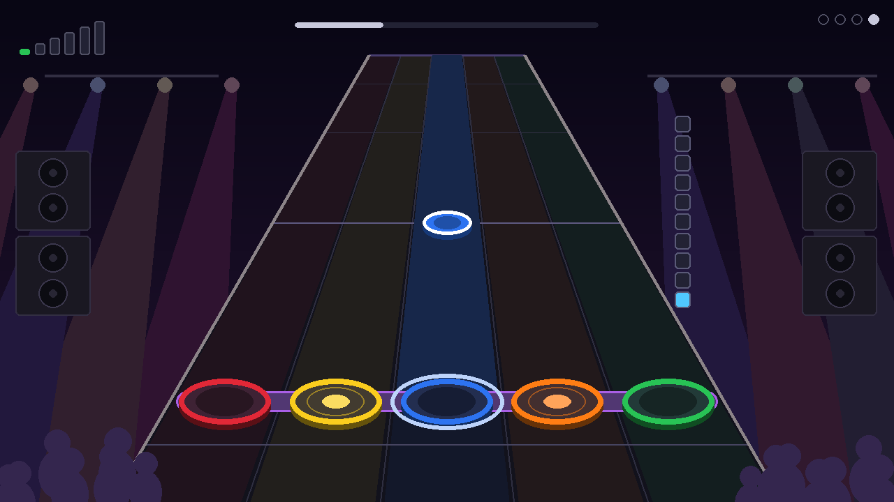
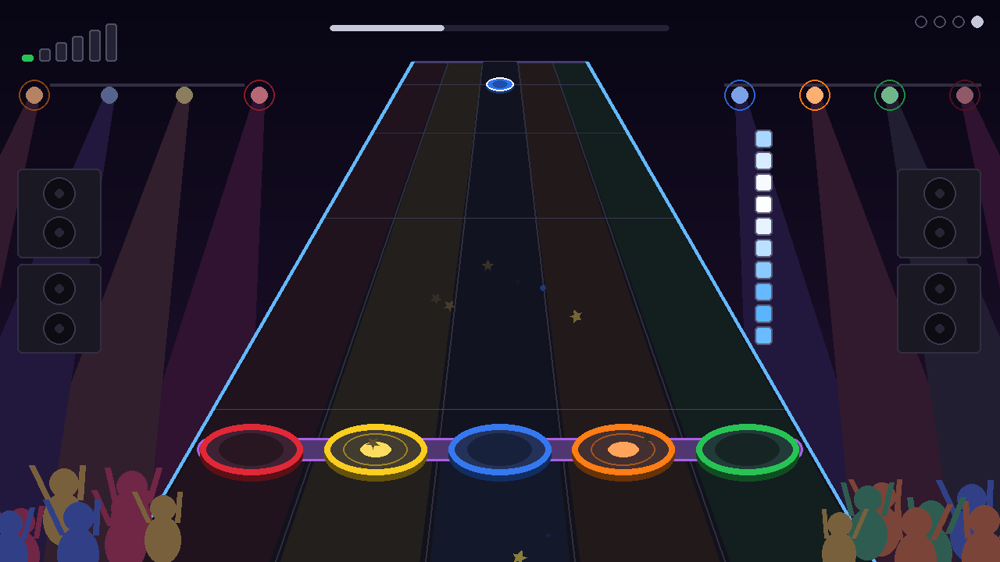
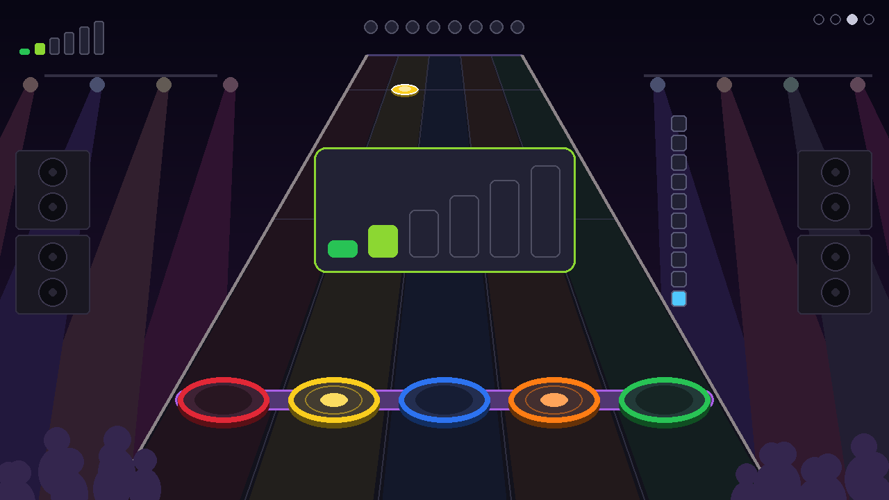
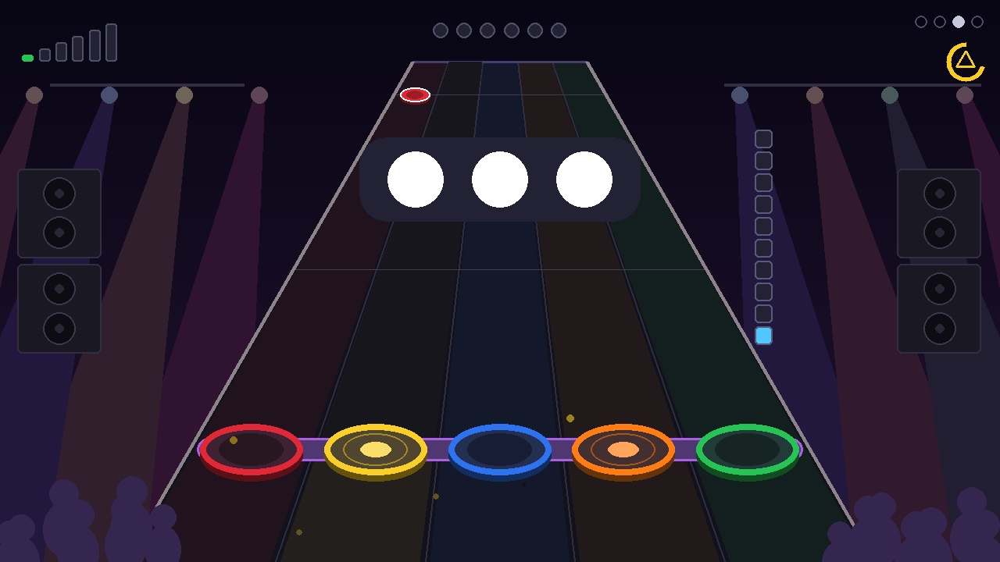

# PiDrum

Batterie d'apprentissage pour jeune enfant : kit Guitar Hero (PS3) + Raspberry Pi 4 + TV.
Aucun texte à l'écran, tout passe par les couleurs, les sons et les animations.

## Aperçu

Habillage façon **Guitar Hero / Rock Band** : une autoroute de notes en perspective sur une scène de concert, avec cinq cibles de couleur sur la ligne de frappe dans l'ordre du kit (rouge, jaune, bleu, orange, vert) et la barre violette de la pédale en travers. Les gemmes descendent l'autoroute et chaque frappe allume la cible, envoie une flamme et fait sauter la foule. Les cymbales ont leur propre forme (cloche au centre), aussi bien sur les cibles que sur les gemmes.

| Jeu libre | Copie-moi | Le beat |
|---|---|---|
|  |  |  |
| Chaque frappe : son, flamme et piste allumée | La piste attendue s'allume, sa cible pulse en blanc | Les gemmes arrivent sur la cible pile au temps |

| Chanson | Star power | Niveaux |
|---|---|---|
|  |  |  |
| Les notes descendent sur la musique | Jauge pleine : l'autoroute devient bleue | Triangle ou X maintenu : l'escalier des niveaux |

| Bouton de façade | Changement de mode | Extinction |
|---|---|---|
|  |  |  |
| Appui long : jauge et symbole du bouton | Appui long sur START : 1 à 4 gros points | SELECT + START : la télé « s'éteint » |

Ces images sont produites par `test_pidrum.py` (copies dans `docs/images/`).

## Fichiers

- `pidrum.py` : l'application (4 modes, 6 niveaux chacun)
- `sounds.py` : synthèse des sons de batterie (aucun fichier audio requis)
- `songs.py` : comptines du mode chanson (mélodies, partitions par niveau, synthèse de la musique) et accompagnements du jeu libre
- `map_pads.py` : détection des boutons du kit, génère `pads.json`
- `pidrum.service` : démarrage automatique au boot
- `test_pidrum.py` : tests headless (aucun kit ni écran requis), captures dans `shots/`

## Modes

Appui **long** (1,5 s) sur START du kit pour passer au mode suivant. Une jauge apparaît en haut à droite pendant l'appui, puis 1 à 4 gros points indiquent le mode choisi. Un appui court est ignoré, donc l'enfant ne change pas de mode par accident.

1. **Jeu libre** : chaque pad joue son son, allume sa cible et sa piste. Selon le niveau, un accompagnement en boucle (basse, accords, shaker, sans batterie) joue de plus en plus vite et dense, et l'autoroute défile à son tempo. Après 20 s sans frappe, une cible « appelle » doucement l'enfant.
2. **Copie-moi** : des gemmes descendent l'autoroute et jouent leur son en touchant la ligne, puis l'enfant reproduit la séquence. La piste attendue s'allume et sa cible pulse en blanc. Les points en haut montrent la longueur de la séquence. Après 3 réussites, la séquence s'allonge. Après plusieurs erreurs, elle raccourcit. Il n'y a jamais de son d'échec.
3. **Le beat** : métronome et gemmes qui arrivent sur la cible pile au temps (croches à partir du niveau intermédiaire). Chaque bonne frappe remplit un point en haut. Quand tous les points sont pleins, une fanfare joue et le motif suivant commence.
4. **Chanson** : une comptine du domaine public joue (*Frère Jacques*, *Au clair de la lune*, *Ah ! vous dirai-je maman*, synthétisées). Les notes descendent l'autoroute, la piste visée s'allume à l'approche, et une note frappée à temps donne des étoiles. Une note manquée s'efface doucement : la chanson va toujours au bout, puis une fête lance la suivante.

**Star power** : chaque bonne frappe remplit la jauge verticale à droite de l'autoroute (en jeu libre, chaque frappe compte un peu). Pleine, elle déclenche 8 s de star power : bords de l'autoroute bleus, projecteurs qui clignotent, foule debout et applaudissements. La jauge ne descend jamais sur une erreur.

## Boutons de façade et niveaux

Les 4 boutons du boîtier servent au parent. Il faut les **maintenir 0,8 s** : une jauge de la couleur du bouton apparaît en haut à droite avec son symbole, puis l'action part une seule fois par appui.

| Bouton | Action |
|---|---|
| △ triangle | niveau plus difficile pour le jeu en cours |
| ✕ croix | niveau plus facile |
| ○ rond | mode suivant |
| □ carré | mode précédent |

Sur le GH World Tour PS3, chaque bouton envoie le **même code que le pad de sa couleur** (rond = rouge, carré = bleu, X = vert, triangle = jaune). Un coup de baguette ne dure que quelques millisecondes : seul un appui maintenu compte comme bouton. L'appui joue quand même le son du pad, une fois, au début. Le triangle fonctionne même si la cymbale jaune est désactivée (connecteur cassé). Si ton kit a des codes propres pour ces boutons, `map_pads.py` les détecte et les écrit dans `pads.json` (`"buttons"`).

Chaque jeu a **6 niveaux**, réglés séparément et mémorisés dans `progress.json` (non versionné) : apprenti, novice, débutant, intermédiaire, avancé, expert. L'escalier en haut à gauche montre le niveau joué. Après un changement, un grand escalier s'affiche au centre (vert, vert clair, jaune, orange, rouge, violet, comme les difficultés de Guitar Hero).

| Niveau | Jeu libre | Copie-moi | Le beat | Chanson |
|---|---|---|---|---|
| apprenti | silence | 1 pad, peaux seulement, indice tout de suite | 60 BPM, une couleur | une note par mesure, peaux seulement |
| novice | pulsation 72 BPM | 1 à 2 pads | 70 BPM, cymbales et paires | tous les 2 temps, peaux |
| débutant | basse 80 BPM | 2 à 3 pads | 76 BPM, motifs de 4 | tous les 2 temps, 5 pads |
| intermédiaire | pop 90 BPM | 2 à 4 pads | 84 BPM, croches | chaque temps |
| avancé | rock 100 BPM | 3 à 5 pads, plus rapide | 96 BPM, croches serrées | toutes les notes |
| expert | funk 110 BPM | 4 à 6 pads | 108 BPM, 16 frappes par motif | toutes les notes + accords de cymbale |

Le niveau choisi est un plafond, pas une contrainte : si l'enfant peine (erreurs dans *Copie-moi*, gemmes ratées alors qu'il joue dans *Le beat*, moins de 30 % des notes d'une chanson), le jeu redescend tout seul d'un niveau. Il remonte ensuite après des réussites, sans dépasser le niveau choisi. Un contour blanc sur l'escalier marque le niveau choisi tant qu'il n'est pas rejoint. Les tolérances de temps se resserrent avec le niveau (0,30 à 0,15 s dans *Le beat*, 0,35 à 0,18 s en chanson).

**Éteindre le Pi proprement** : maintenir **SELECT + START** ensemble 3 s. La jauge en haut à droite devient bleue, puis une petite mélodie descendante joue et l'écran s'éteint comme une vieille télé. Attendre que la LED verte du Pi ne clignote plus avant de couper le courant. Cela évite de corrompre la carte SD. Nécessite la règle sudoers (voir « Démarrage automatique »). Sans elle, le jeu reprend simplement et le journal l'indique.

Le clavier fonctionne aussi pour les tests : `1` à `5` pour les pads, espace pour la pédale, Entrée pour START, Tab pour SELECT, les flèches pour les boutons de façade (haut △, bas ✕, droite ○, gauche □, à maintenir) et Échap pour quitter.

## Installation sur le Pi

Installer **Raspberry Pi OS Lite (64-bit)** avec Raspberry Pi Imager en activant SSH. La version actuelle est basée sur Debian 13 (Trixie). Bookworm fonctionne aussi. Ensuite, sur le Pi :

```
sudo apt update
```
```
sudo apt install -y git python3-pygame python3-numpy python3-evdev evtest
```
```
sudo usermod -aG input,video,render,audio $USER
```
```
git clone https://github.com/rubbermaid123/pidrum.git ~/pidrum
```

Se déconnecter puis se reconnecter en SSH pour que les groupes s'appliquent, puis vérifier :

```
groups
```

Si l'image installée est la version **avec bureau**, le bureau occupe l'écran et PiDrum ne peut pas l'utiliser. Démarrer en mode console (réversible avec `graphical.target`) :

```
sudo systemctl set-default multi-user.target
```

Mises à jour ultérieures :

```
cd ~/pidrum && git pull && sudo systemctl restart pidrum
```

Vérifier que tout fonctionne sur le Pi, sans kit ni écran (arrêter le service avant s'il tourne déjà) :

```
cd ~/pidrum && python3 test_pidrum.py
```

## Mapping du kit (une seule fois)

Brancher le dongle, allumer le kit, puis :

```
cd ~/pidrum && python3 map_pads.py
```

Le script demande de frapper chaque élément 3 fois, puis d'appuyer sur START et SELECT, puis (facultatif) deux fois sur chaque bouton de façade. Pour passer cette dernière étape, attendre 10 s sans rien presser par bouton. Il affiche les touches vues pour chaque frappe, puis écrit `pads.json`. Attention, il réécrit le fichier : remettre ensuite `disabled` et `velocity` s'ils y étaient.

- Si un élément n'a pas de bouton à lui (kit qui envoie couleur + modificateur), le script enregistre la **combinaison** de boutons, par exemple `"yellow": [304, 401]`. `pidrum.py` sait la lire. C'est signalé sous « ATTENTION » : vérifier en jeu libre que chaque élément joue le bon son.
- S'il reste un conflit (même combinaison pour deux éléments), envoie-moi la sortie de `sudo evtest` pendant que tu frappes les pads.

**Élément cassé** : l'ajouter à une liste `disabled` dans `pads.json`, par exemple `"disabled": ["yellow", "kick"]`, puis redémarrer le service. Il disparaît de l'écran et les jeux ne le demandent plus. Le retirer de la liste une fois réparé.

### Force de frappe (vélocité)

Le pilote générique n'expose pas la force : elle est lue directement dans les rapports USB bruts (`/dev/hidrawN`), puis règle le volume de chaque coup. Un coup doux joue à 90 % du son normal, un coup fort à 150 % : une variante plus puissante de chaque son, pré-calculée sans écrêter (`VEL_*` en haut de `pidrum.py`). Sans cette lecture, tout joue à plein volume, comme avant.

1. Autoriser le groupe `input` à lire les rapports bruts du kit (uniquement `12ba:0120`) :

```
sudo cp ~/pidrum/99-pidrum-hidraw.rules /etc/udev/rules.d/
```
```
sudo udevadm control --reload && sudo udevadm trigger
```

2. Indiquer dans `pads.json` l'octet de force de chaque pad (relevé sur le GH World Tour PS3) :

```json
"velocity": {"report_bytes": {"red": 12, "green": 13, "blue": 14, "orange": 16}}
```

Le journal affiche alors `Force de frappe : /dev/hidraw0`.

## Test manuel

Depuis SSH, sans bureau :

```
cd ~/pidrum && SDL_VIDEODRIVER=kmsdrm python3 pidrum.py
```

Ctrl+C pour arrêter.

## Audio et latence

C'est le point critique pour un instrument de percussion.

- Le kit est lu dans un thread dédié qui déclenche le son dès la frappe, indépendamment du rendu. L'attente de synchronisation verticale de l'écran n'ajoute donc pas de délai.
- Lister les cartes : `aplay -l`. Sur le Pi 4 : `vc4hdmi0` (port HDMI côté alimentation), `vc4hdmi1` (port HDMI côté jack), `Headphones` (jack 3,5 mm).
- **Choix automatique** (`AUDIO_OUTPUT = "auto"` en haut de `pidrum.py`) : le port HDMI dont l'écran accepte l'audio (il le déclare via HDMI, `sad_count` > 0 dans `/proc/asound/card*/eld#*`), sinon le jack. Un moniteur sans haut-parleurs donne donc le jack sans rien configurer. `"jack"` ou `"hdmi"` forcent un choix. Le journal indique la sortie retenue.
- Pour forcer une sortie précise sans toucher au code, définir `AUDIODEV` dans une surcharge systemd locale (hors dépôt) :

```
sudo mkdir -p /etc/systemd/system/pidrum.service.d
```
```
printf '[Service]\nEnvironment=AUDIODEV=plughw:CARD=vc4hdmi1,DEV=0\n' | sudo tee /etc/systemd/system/pidrum.service.d/audio.conf
```
```
sudo systemctl daemon-reload && sudo systemctl restart pidrum
```

  Remplacer `vc4hdmi1` par `vc4hdmi0` ou `Headphones` selon la sortie. Tester une sortie : `speaker-test -D plughw:CARD=vc4hdmi1,DEV=0 -c 2 -t sine -l 1`

- **HDMI** : mettre la TV en **mode Jeu**. Sinon, son traitement interne ajoute facilement 50 à 100 ms et le décalage se sent.
- **Jack 3,5 mm vers une petite enceinte** : c'est souvent la meilleure latence. La TV ne sert alors qu'à l'image.
- En cas de craquements, monter `AUDIO_BUFFER` de 256 à 512 en haut de `pidrum.py`.
- Si les frappes semblent jugées « en retard » dans *Le beat*, ajuster `JUDGE_OFFSET` (par exemple `0.05`).

## Démarrage automatique

```
sed "s/__USER__/$USER/g" ~/pidrum/pidrum.service | sudo tee /etc/systemd/system/pidrum.service
```
```
sudo systemctl daemon-reload
```
```
sudo systemctl enable --now pidrum
```

Autoriser l'extinction par SELECT + START (uniquement `systemctl poweroff`, rien d'autre) :

```
sed "s/__USER__/$USER/g" ~/pidrum/pidrum-poweroff.sudoers | sudo tee /etc/sudoers.d/pidrum-poweroff
```
```
sudo chmod 440 /etc/sudoers.d/pidrum-poweroff && sudo visudo -cf /etc/sudoers.d/pidrum-poweroff
```
```
journalctl -u pidrum -f
```

Si l'écran reste noir avec le service actif, la console occupe peut-être l'affichage :

```
sudo systemctl disable --now getty@tty1
```

## Réglages

Tout est en haut de `pidrum.py` : les tables de niveaux `FREE_LEVELS`, `COPY_LEVELS`, `BEAT_LEVELS` (tempo, tolérance, motifs) et `SONG_LEVELS` (densité, tolérance, vitesse des notes), `BUTTON_HOLD` et `BUTTON_ACTIONS` (boutons de façade), `KICK_IN_GAMES` (inclure la pédale dans les jeux, désactivé par défaut pour un enfant de 3 ans), `HOLD_TO_SWITCH`, l'énergie (`ENERGY_*`, `STAR_TIME`), la géométrie de l'autoroute (`HIGHWAY_*`, `STRIKE_Y`) et les délais et seuils de *Copie-moi* (`COPY_*`).

Pour remettre tous les niveaux à apprenti : `rm ~/pidrum/progress.json` puis redémarrer le service.

## Pistes pour la suite

- Vrais échantillons .wav à la place des sons synthétisés
- Chansons : charger tes propres fichiers audio avec une partition à côté
