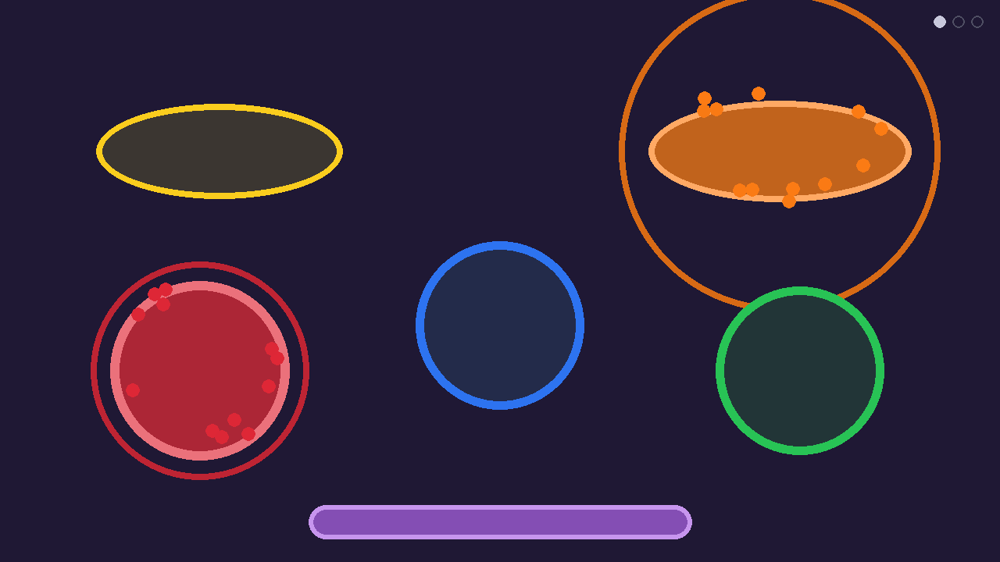
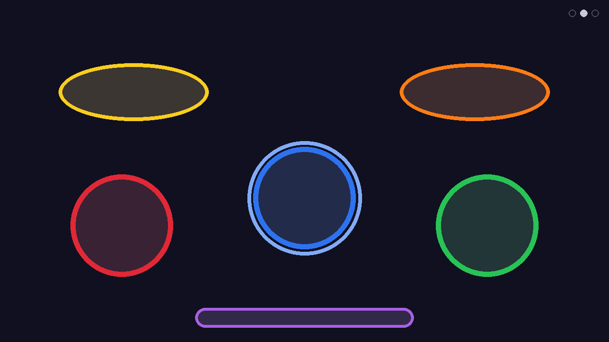
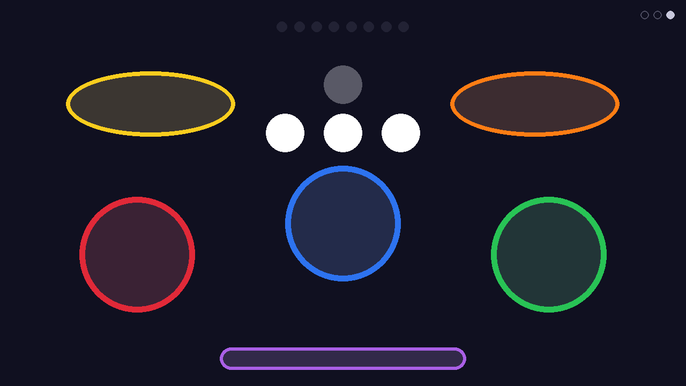

# PiDrum

Batterie d'apprentissage pour jeune enfant : kit Guitar Hero (PS3) + Raspberry Pi 4 + TV.
Aucun texte à l'écran, tout passe par les couleurs, les sons et les animations.

## Aperçu

L'écran reproduit le kit vu par l'enfant : cymbales en haut, pads au milieu, pédale en bas.

| Jeu libre | Copie-moi | Le beat |
|---|---|---|
|  |  |  |
| Chaque frappe : son, éclat et onde | Le pad attendu pulse en blanc | L'anneau se referme sur le pad pile au temps |

| Changement de mode | Extinction |
|---|---|
|  |  |
| Appui long sur START : 1, 2 ou 3 gros points | SELECT + START : la télé « s'éteint » |

Ces images sont produites par `test_pidrum.py` (copies dans `docs/images/`).

## Fichiers

- `pidrum.py` : l'application (3 modes)
- `sounds.py` : synthèse des sons de batterie (aucun fichier audio requis)
- `map_pads.py` : détection des boutons du kit, génère `pads.json`
- `pidrum.service` : démarrage automatique au boot
- `test_pidrum.py` : tests headless (aucun kit ni écran requis), captures dans `shots/`

## Modes

Appui **long** (1,5 s) sur START du kit pour passer au mode suivant. Une jauge apparaît en haut à droite pendant l'appui, puis 1, 2 ou 3 gros points indiquent le mode choisi. Un appui court est ignoré, donc l'enfant ne change pas de mode par accident.

1. **Jeu libre** : chaque pad joue son son et s'illumine. Après 20 s sans frappe, un pad « appelle » doucement l'enfant.
2. **Copie-moi** : le jeu joue un pad (ou une séquence) et l'enfant le reproduit. Le pad attendu clignote en blanc. Après 3 réussites, la séquence s'allonge (max 4). Après plusieurs erreurs, elle raccourcit. Il n'y a jamais de son d'échec.
3. **Le beat** : métronome à 70 BPM. Un anneau blanc se referme sur le pad à frapper et le touche exactement sur le temps. Chaque bonne frappe remplit un point en haut. À 8 points, une fanfare joue et le motif suivant commence (une couleur, puis deux en alternance, etc.).

**Éteindre le Pi proprement** : maintenir **SELECT + START** ensemble 3 s. La jauge en haut à droite devient bleue, puis une petite mélodie descendante joue et l'écran s'éteint comme une vieille télé. Attendre que la LED verte du Pi ne clignote plus avant de couper le courant. Cela évite de corrompre la carte SD. Nécessite la règle sudoers (voir « Démarrage automatique »). Sans elle, le jeu reprend simplement et le journal l'indique.

Le clavier fonctionne aussi pour les tests : `1` à `5` pour les pads, espace pour la pédale, Entrée pour START, Tab pour SELECT et Échap pour quitter.

## Installation sur le Pi

Installer **Raspberry Pi OS Lite (64-bit)** avec Raspberry Pi Imager en activant SSH. La version actuelle est basée sur Debian 13 (Trixie). Bookworm fonctionne aussi. Ensuite, sur le Pi :

```
sudo apt update
```
```
sudo apt install -y git python3-pygame python3-numpy python3-evdev evtest
```
```
sudo usermod -aG input,video,render,audio $USER
```
```
git clone https://github.com/rubbermaid123/pidrum.git ~/pidrum
```

Se déconnecter puis se reconnecter en SSH pour que les groupes s'appliquent, puis vérifier :

```
groups
```

Si l'image installée est la version **avec bureau**, le bureau occupe l'écran et PiDrum ne peut pas l'utiliser. Démarrer en mode console (réversible avec `graphical.target`) :

```
sudo systemctl set-default multi-user.target
```

Mises à jour ultérieures :

```
cd ~/pidrum && git pull && sudo systemctl restart pidrum
```

Vérifier que tout fonctionne sur le Pi, sans kit ni écran (arrêter le service avant s'il tourne déjà) :

```
cd ~/pidrum && python3 test_pidrum.py
```

## Mapping du kit (une seule fois)

Brancher le dongle, allumer le kit, puis :

```
cd ~/pidrum && python3 map_pads.py
```

Le script demande de frapper chaque élément 3 fois, puis d'appuyer sur START et SELECT. Il affiche les touches vues pour chaque frappe, puis écrit `pads.json`.

- Si un élément n'a pas de bouton à lui (kit qui envoie couleur + modificateur), le script enregistre la **combinaison** de boutons, par exemple `"yellow": [304, 401]`. `pidrum.py` sait la lire. C'est signalé sous « ATTENTION » : vérifier en jeu libre que chaque élément joue le bon son.
- S'il reste un conflit (même combinaison pour deux éléments), envoie-moi la sortie de `sudo evtest` pendant que tu frappes les pads.

**Élément cassé** : l'ajouter à une liste `disabled` dans `pads.json`, par exemple `"disabled": ["yellow", "kick"]`, puis redémarrer le service. Il disparaît de l'écran et les jeux ne le demandent plus. Le retirer de la liste une fois réparé.

La sortie liste aussi les axes analogiques qui bougent pendant les frappes. On s'en servira pour gérer la vélocité (nuances) dans une prochaine version.

## Test manuel

Depuis SSH, sans bureau :

```
cd ~/pidrum && SDL_VIDEODRIVER=kmsdrm python3 pidrum.py
```

Ctrl+C pour arrêter.

## Audio et latence

C'est le point critique pour un instrument de percussion.

- Le kit est lu dans un thread dédié qui déclenche le son dès la frappe, indépendamment du rendu. L'attente de synchronisation verticale de l'écran n'ajoute donc pas de délai.
- Lister les cartes : `aplay -l`. Sur le Pi 4 : `vc4hdmi0` (port HDMI côté alimentation), `vc4hdmi1` (port HDMI côté jack), `Headphones` (jack 3,5 mm).
- **Choix automatique** (`AUDIO_OUTPUT = "auto"` en haut de `pidrum.py`) : le port HDMI dont l'écran accepte l'audio (il le déclare via HDMI, `sad_count` > 0 dans `/proc/asound/card*/eld#*`), sinon le jack. Un moniteur sans haut-parleurs donne donc le jack sans rien configurer. `"jack"` ou `"hdmi"` forcent un choix. Le journal indique la sortie retenue.
- Pour forcer une sortie précise sans toucher au code, définir `AUDIODEV` dans une surcharge systemd locale (hors dépôt) :

```
sudo mkdir -p /etc/systemd/system/pidrum.service.d
```
```
printf '[Service]\nEnvironment=AUDIODEV=plughw:CARD=vc4hdmi1,DEV=0\n' | sudo tee /etc/systemd/system/pidrum.service.d/audio.conf
```
```
sudo systemctl daemon-reload && sudo systemctl restart pidrum
```

  Remplacer `vc4hdmi1` par `vc4hdmi0` ou `Headphones` selon la sortie. Tester une sortie : `speaker-test -D plughw:CARD=vc4hdmi1,DEV=0 -c 2 -t sine -l 1`

- **HDMI** : mettre la TV en **mode Jeu**. Sinon, son traitement interne ajoute facilement 50 à 100 ms et le décalage se sent.
- **Jack 3,5 mm vers une petite enceinte** : c'est souvent la meilleure latence. La TV ne sert alors qu'à l'image.
- En cas de craquements, monter `AUDIO_BUFFER` de 256 à 512 en haut de `pidrum.py`.
- Si les frappes semblent jugées « en retard » dans *Le beat*, ajuster `JUDGE_OFFSET` (par exemple `0.05`).

## Démarrage automatique

```
sed "s/__USER__/$USER/g" ~/pidrum/pidrum.service | sudo tee /etc/systemd/system/pidrum.service
```
```
sudo systemctl daemon-reload
```
```
sudo systemctl enable --now pidrum
```

Autoriser l'extinction par SELECT + START (uniquement `systemctl poweroff`, rien d'autre) :

```
sed "s/__USER__/$USER/g" ~/pidrum/pidrum-poweroff.sudoers | sudo tee /etc/sudoers.d/pidrum-poweroff
```
```
sudo chmod 440 /etc/sudoers.d/pidrum-poweroff && sudo visudo -cf /etc/sudoers.d/pidrum-poweroff
```
```
journalctl -u pidrum -f
```

Si l'écran reste noir avec le service actif, la console occupe peut-être l'affichage :

```
sudo systemctl disable --now getty@tty1
```

## Réglages

Tout est en haut de `pidrum.py` : `BPM`, `BEAT_WINDOW` (tolérance), `BEAT_GOAL`, `KICK_IN_GAMES` (inclure la pédale dans les jeux, désactivé par défaut pour un enfant de 3 ans), `SIMON_MAX_LEN`, `HOLD_TO_SWITCH`, ainsi que les délais et seuils de *Copie-moi* (`COPY_*`).

## Pistes pour la suite

- Vélocité : volume selon la force de frappe, une fois les axes connus
- Vrais échantillons .wav à la place des sons synthétisés
- Mode « chanson » : accompagnement musical simple sur lequel taper le beat
